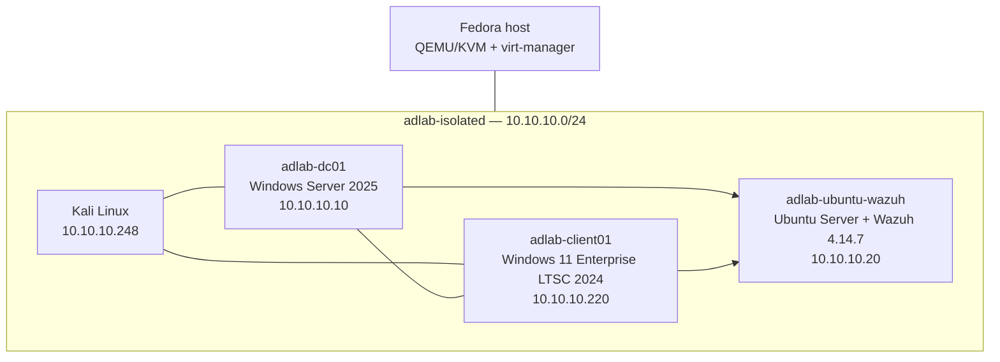

# Active Directory Attack & Detection Lab

A self-contained Active Directory security lab built with QEMU/KVM to reproduce three credential-access and authentication techniques, examine the Windows telemetry they generate, and validate what a Wazuh SIEM collects and alerts on.

> **Scope and safety:** This project was conducted in a privately controlled, isolated virtual network for learning and detection engineering. The commands and observations are documented for that lab only. Do not use them against systems or accounts without explicit authorization.

## Project goals

- Build a small Active Directory domain with a Domain Controller, a domain-joined Windows client, and deliberately configured test accounts.
- Reproduce Kerberoasting, Pass-the-Hash, and LLMNR/NBT-NS poisoning in the isolated lab.
- Identify the Windows events and network telemetry produced by each experiment.
- Forward Windows endpoint events to Wazuh and distinguish event collection from rule-generated alerts.
- Record limitations and false-positive risks rather than claiming detections that were not demonstrated.

## Lab environment

The virtual machines were hosted on Fedora Linux using QEMU/KVM and virt-manager. They communicated over the isolated libvirt network `adlab-isolated` (`10.10.10.0/24`). The VMs were not intended to be reachable from the host's normal LAN.

| Role              | VM name              | Guest hostname / identity | OS                                         | Lab IP                                   |
| ----------------- | -------------------- | ------------------------- | ------------------------------------------ | ---------------------------------------- |
| Attacker          | `kali-learning-box`  | `speedster`               | Kali Linux 2026.3                          | `10.10.10.248` during the captured tests |
| Domain Controller | `adlab-dc01`         | `WIN-4JLEJOTK4QI`         | Windows Server 2025 Standard Evaluation    | `10.10.10.10`                            |
| Domain client     | `adlab-client01`     | `DESKTOP-9J6SCIV`         | Windows 11 Enterprise LTSC 2024 Evaluation | `10.10.10.220`                           |
| SIEM              | `adlab-ubuntu-wazuh` | `ubu_speedster`           | Ubuntu Server LTS 24.04                    | `10.10.10.20`                            |

**Naming note:** VM names, guest OS hostnames, and Wazuh agent names are separate identifiers. The Wazuh agent names used were `adlab-dc01` and `adlab-client01`.

## Architecture



See [docs/lab-topology.md](docs/lab-topology.md) for the addressing, Active Directory layout, and telemetry flow.

## Active Directory design

- Domain: `LAB.LOCAL` (DNS name `lab.local`).
- Organizational units observed: `Domain Controllers`, `Lab-Admins`, `Lab-ServiceAccounts`, `Lab-Users`, and `Lab-Workstations`.
- Kerberoasting test account: `svc_sql` (display name `SQL Service`), placed in `Lab-ServiceAccounts` and configured with an MSSQL service principal name.
- Requesting domain user used in the Kerberoasting test: `bsilverhand`.
- Other lab user names observed during directory inspection included Ben Silverhand, Bill NotGates, Johnny Diamondhead, Mark Altman, Sam Zuckerberg, and Thomson Vercetti.

The lab's account names and structure were chosen for a small fictional organization. Passwords, password hashes, enrollment secrets, and other credential material are deliberately not published.

## Experiments and outcomes

| Experiment | MITRE ATT&CK | Demonstrated outcome | Detection / telemetry result |
|---|---|---|---|
| Kerberoasting | [T1558.003](https://attack.mitre.org/techniques/T1558/003/) | Requested a TGS for `svc_sql`; the AES256 ticket hash was recovered offline in the lab. | DC Event 4769 for `bsilverhand` → `svc_sql` was present in Wazuh archives. No corresponding alert for that 4769 was observed. A separate Event 4624 at the same time triggered Wazuh rule 92652 for NTLM remote logon. |
| Pass-the-Hash | [T1550.002](https://attack.mitre.org/techniques/T1550/002/) | Used the client's local Administrator NTLM hash with Impacket `wmiexec.py`; a remote shell was obtained. | Client Event 4624 showed a successful NTLMv2 network logon from Kali. The user confirmed the event activity around 20:14 appeared in both Wazuh archives and alerts for `adlab-client01`; the exact client-side alert rule ID/level was not recorded. |
| LLMNR/NBT-NS poisoning | [T1557.001](https://attack.mitre.org/techniques/T1557/001/) | Responder captured an NTLMv2 response after a name-resolution failure; the tested wordlist did not recover the password. | tcpdump showed LLMNR traffic on UDP/5355. NBT-NS traffic was not confirmed in the supplied capture. Wazuh network-layer detection was not configured or tested. |

Detailed reports: [Kerberoasting](attacks/kerberoasting.md), [Pass-the-Hash](attacks/pass-the-hash.md), and [LLMNR/NBT-NS poisoning](attacks/llmnr-poisoning.md).

## Wazuh deployment and validation

Wazuh 4.14.7 was installed as an all-in-one manager/indexer/dashboard VM at `10.10.10.20`. Windows agents were installed on both Windows endpoints and enrolled under the names `adlab-dc01` and `adlab-client01`. At the end of the deployment work, both agents appeared as **Active** in the manager and dashboard.

The validation distinguished three different outcomes:

1. **Event generated:** Windows recorded the event in its Security log.
2. **Event collected / archived:** the event reached Wazuh and appeared in `wazuh-archives-*`.
3. **Alert generated:** an event matched a Wazuh rule and appeared in `wazuh-alerts-*`.

For the Kerberoasting run, the specific Event 4769 was archived but did not produce a corresponding alert. A separate DC-side Event 4624 for `LAB\bsilverhand`, using NTLM from `10.10.10.248`, generated rule `92652` at level 6. That rule's description says “possible pass-the-hash,” but its condition checks remote IPv4 logon followed by an NTLM authentication package; it does not prove hash reuse or detect Kerberoasting specifically. Separately, for the client-side Pass-the-Hash test around 20:14, the user confirmed that Event 4624 activity appeared in both Wazuh archives and alerts for `adlab-client01`; the exact client-side rule ID and level were not recorded.

The Wazuh built-in ruleset was examined. The chain observed was `60103` (Windows audit success) → `60106` (Windows logon success, including event IDs 4624 and 4769) → `92651` (remote IPv4 address, excluding `127.0.0.1`) → `92652` (authentication package `NTLM`). The Kerberos Event 4769 used an IPv4-mapped IPv6 address (`::ffff:10.10.10.248`) and was Kerberos ticket telemetry, not NTLM. The address-family mismatch is a plausible reason it did not enter the remote-NTLM child-rule chain; it is documented as an analysis, not as a fully isolated root-cause test.

**Sigma vs. Wazuh:** The repository's detection YAML files are separate Sigma-format artifacts. They were not automatically imported or executed by Wazuh merely because they exist. The rule 92652 alert came from Wazuh's packaged ruleset. This project does not claim that its Sigma YAML rules were directly executed by Wazuh.

See [docs/wazuh-validation.md](docs/wazuh-validation.md) for event fields, rule behavior, and evidence status. Remaining unverified publication items are listed in [docs/remaining-confirmations.md](docs/remaining-confirmations.md).

## MITRE ATT&CK mapping

| Experiment | Technique | Tactic |
|---|---|---|
| Kerberoasting | [T1558.003 — Kerberoasting](https://attack.mitre.org/techniques/T1558/003/) | Credential Access |
| Pass-the-Hash | [T1550.002 — Pass the Hash](https://attack.mitre.org/techniques/T1550/002/) | Lateral Movement |
| LLMNR/NBT-NS poisoning | [T1557.001 — Name Resolution Poisoning and SMB Relay](https://attack.mitre.org/techniques/T1557/001/) | Credential Access / Adversary-in-the-Middle context |

See [docs/mitre-attack-mapping.md](docs/mitre-attack-mapping.md).

## Repository layout

```text
.
├── README.md
├── attacks/
│   ├── kerberoasting.md
│   ├── pass-the-hash.md
│   └── llmnr-poisoning.md
├── detections/
│   └── (Sigma YAML artifacts; see each file for its exact status)
└── docs/
    ├── lab-topology.md
    ├── mitre-attack-mapping.md
    ├── wazuh-validation.md
    ├── deviations-and-lessons.md
    ├── evidence-index.md
    └── screenshots/
```

## Authorization

All experiments were performed against my own isolated virtual machines and fictional Active Directory domain. No third-party systems were in scope.
